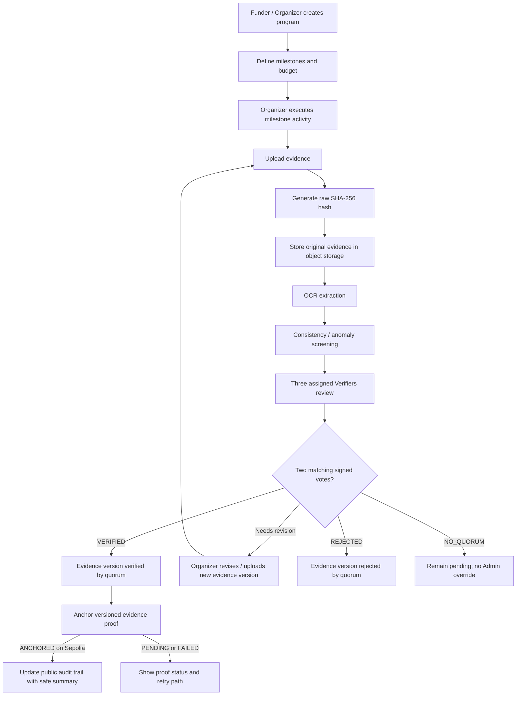

# DanaTerang — User Flow

## 1. End-to-End Core Flow



## 2. Main Use Case

### Example: CSR School Renovation

A company or community creates a public fundraising campaign with a target of IDR 100,000,000 for a school renovation program. The target is not a donation cap.

Milestones:

- Material purchase — IDR 30,000,000
- Structural renovation — IDR 40,000,000
- Finishing — IDR 30,000,000

The NGO uploads:

- receipts,
- invoices,
- progress photos,
- activity report.

DanaTerang:

1. hashes the original files,
2. stores the files,
3. extracts receipt data,
4. detects inconsistencies,
5. sends the case to an assigned peer panel,
6. shows whether the submitted evidence version is approved, requires revision, or rejected,
7. records the verifier decision against the reviewed evidence version,
8. anchors a versioned proof commitment,
9. exposes a non-sensitive summary and proof on the public audit page.

Many authenticated Funder accounts can donate through a Rupiah payment provider. Funds enter campaign escrow, not the Organizer's account. At H-48, only the authorized Organizer signs the final campaign terms; fundraising continues to the scheduled close. If no signature arrives, fundraising is cancelled and refunds are queued. When a verified milestone completes, escrow can fund its payout through the provider. Provider fees, refunds, payouts, related-cause transfers, and remaining escrow are reconciled in the ledger. See `../docs/specs/2026-11-21-public-fundraising-escrow-design.md`.

## 3. Tracking-Only Mode

```mermaid
sequenceDiagram
    participant F as Funder
    participant O as Organizer
    participant D as DanaTerang
    participant V as Assigned Verifier Panel (3)
    participant B as Blockchain

    F->>D: Authenticated donation checkout (Rupiah payment provider)
    D->>D: Provider confirms settlement; credit campaign escrow ledger
    O->>B: Sign final terms snapshot at H-48
    O->>D: Create milestone evidence
    D->>D: Hash + OCR + screening
    D->>V: Assign version-specific peer review
    V->>B: Submit EIP-712 vote signature (relayed; service pays gas)
    B-->>D: Finalize matching 2-of-3 outcome
    D->>B: Anchor evidence/review proof
    opt Verified milestone is ready for payout
        O->>D: Request milestone payout
        D->>F: Provider pays verified recipient from escrow
    end
    D-->>F: Updated audit trail
```

## 4. Optional External Payment Report

Rupiah checkout, escrow custody, refunds, and payouts are handled by a payment provider/escrow partner; DanaTerang does not hold or transfer Rupiah itself. The backend records verified provider settlement events and keeps a balanced ledger.

Donations are not treated as paid until a signed, verified provider webhook confirms settlement. The ledger separately records provider fees, milestone disbursements, refunds, cause transfers, and escrow balance. The blockchain stores a terms commitment, not a bank transfer or fiat balance.

Optional reporting flow:

```text
Authenticated Donor Pays Through a Provider
→ Verified Provider Webhook Credits Campaign Escrow
→ Verified Milestone Allows Provider Payout
→ Every Fee, Refund, Transfer, and Remaining Balance Reconciles
```

Payment states are separate from verifier and blockchain states: `READY_FOR_PAYMENT` means the funder is authorized to proceed, `PAYMENT_REPORTED` means a funder reported an external transfer, and `CONFIRMED` requires an independent settlement source. Phase 1 may show `PAYMENT_REPORTED` only; it must not infer `CONFIRMED` from a manual report.

## 5. Evidence Revision Flow

Evidence must be versioned.

Do not overwrite history.

```text
Evidence V1
→ Flagged
→ Superseded

Evidence V2
→ Reviewed
→ Verified by 2-of-3 peer quorum
```

Each version must have:

- separate raw hash,
- uploader,
- timestamp,
- status,
- previous version reference.

## 6. Public Verification Flow

Public user opens campaign URL.

The public page may show only information approved for public release:

- campaign title,
- total budget,
- milestone progress,
- evidence status,
- screening result summary,
- verification status,
- optional payment report and its reporting party,
- blockchain proof status.

Original evidence is not downloadable by default. A public user must not be told they can re-hash a private file they cannot access. A blockchain proof confirms the integrity/time of a commitment, not the truth of the submitted evidence.

If an approved redacted derivative is released, show it separately from the private original and display its own redacted-file hash. The original raw hash remains distinct and unchanged.

Technical details such as:

- evidence hash,
- transaction hash,
- block number,
- timestamp

should be available through a secondary detail view.

Canonical package fields and hashing rules are specified in `BlockchainProof.md`, and status domains/transitions are specified in `StatusStateMachines.md`. Publication/consent rules for redacted derivatives and calibrated numeric OCR thresholds remain pilot decisions in `MVPPhases.md`.

The peer quorum, evidence proof, and H-48 campaign terms commitment are anchored on Ethereum Sepolia Testnet and link to Sepolia Etherscan. Assigned Verifiers sign votes with organization-controlled wallets; the authorized Organizer signs only the final campaign terms; donors do not connect wallets. Status fields stay domain-specific as listed in `StatusStateMachines.md`; screening `CLEAR`, quorum verification `VERIFIED`, fundraising `LOCKED`, disbursement `PAYMENT_REPORTED`/provider payout, and proof `ANCHORED` have separate meanings.
